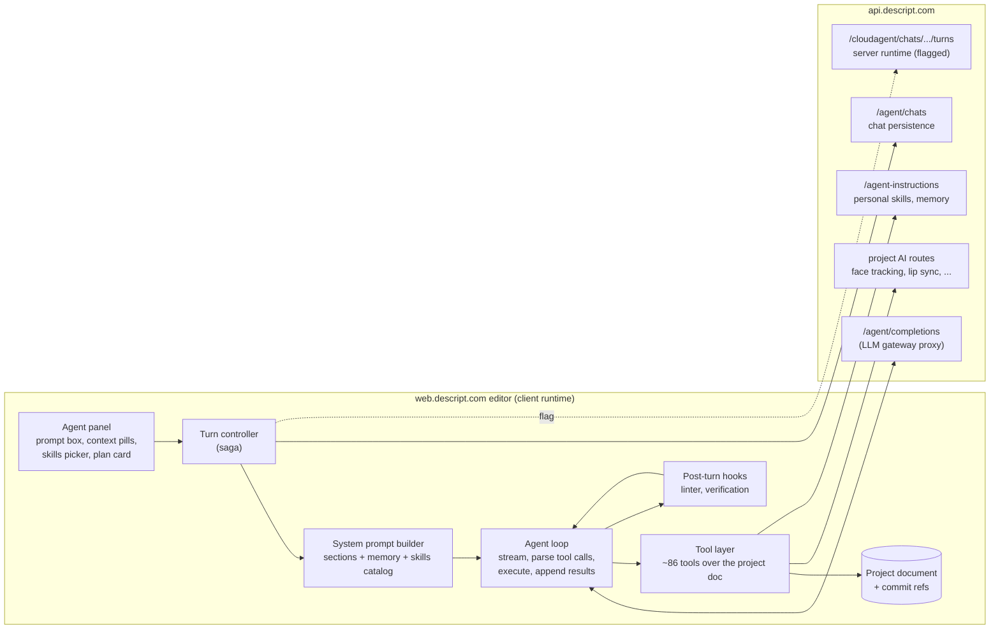

# Underlord: overview and architecture

Clean-room notes on Descript's in-editor AI agent ("Underlord"), written from the public `web.descript.com` bundles of build `react19/9a29d61183bce669600a9dd9a1f8588d708becac` (fetched 2026-10-19). Every chunk we hold locally (41 web chunks plus 10 worker/media chunks) was unpacked with Wakaru 1.14.0 `--unpack=strict` and parsed with an AST pass. Recovered modules stay on the research box. This folder has our descriptions only: no skill bodies, prompt text, or code.

Evidence tags: **decompiled** (read in a Wakaru-recovered module, call sites traced), **static-bundle** (a string or enum seen in the bundle, not traced), **static-help** (help copy), **inferred** (our conclusion).

| File | What it covers |
| --- | --- |
| [skill-library.md](skill-library.md) | All 21 skills in the client registry, their gates and visibility, and a paraphrased workflow for each |
| [skill-graph.md](skill-graph.md) | The `{{sub-skill}}` reference graph as a mermaid diagram, with present vs missing bodies |
| [agent-tools.md](agent-tools.md) | The 86-name tool registry: arguments, what each one changes in the document, where it runs |
| [agent-protocol.md](agent-protocol.md) | How a turn is sent and streamed, tool-call/result messages, planning and approval, rollback, models, credits, chat persistence |
| [signed-in-gaps.md](signed-in-gaps.md) | **Gaps that need a signed-in capture.** Read before the HAR pass |

Pseudocode for our own Underlord-style agent: [../../pseudocode/underlord/](../../pseudocode/underlord/).

## The short version

1. **The agent loop runs in the browser.** (**decompiled**) The editor calls an OpenAI-style chat-completions endpoint on Descript's API (`POST /agent/completions`), streams the reply, and executes every tool call locally against the in-memory project document. Each tool returns text for the model plus an optional new document state. The loop repeats until the model answers without tool calls or a loop cap is hit.
2. **There is also a server-side ("cloud") agent.** (**decompiled**) Behind the `underlord-use-cloud-agent` flag, the client instead posts the user message to `/cloudagent/chats/...` and only renders a server-sent event stream (turn started, assistant chunks, tool started/completed, turn completed). In that mode the client does not run tools. The public `POST /v1/jobs/agent` route is most likely a third front door onto the same server runtime (**inferred**).
3. **A "harness" picks the model, prompt sections and tool set.** (**decompiled**) About 112 harness ids (`mammoth-*`) exist. Each has a main model (Claude, GPT, Gemini, GLM, Kimi or Grok ids routed through an OpenRouter-style gateway), a context limit, a cost tier (`baseline`, `high`, `premium`), loop caps, and one of a few tool sets. "Auto" resolves to a harness chosen by a remote flag.
4. **The system prompt is assembled from sections.** (**decompiled**) Identity, core editing context, tool targeting conventions, script-markup legend, voice tone tags, editing guidelines, visual-tool routing, linter guidance, plus optional blocks for the user's saved preferences ("Underlord Instructions"), admin-disabled feature groups, and a **skills catalog**.
5. **Skills are markdown playbooks the model loads on demand.** (**decompiled**) The catalog lists skill ids, names and one-line descriptions. When a request matches, the model calls `load_skill` and gets the body back as a tool result. Bodies are not pre-expanded into the prompt, and the client never expands `{{sub-skill}}` references: they are left as text for the model to act on by loading that skill or using the matching tools.
6. **First-party macro skills are new and partly hollow.** (**decompiled**) Ten user-facing workflow skills (create clips, edit a talking-head video, edit a podcast, translate and dub, and so on) sit behind the `agent-first-party-macro-skills` flag, dated 2026-09-09 in the flag catalog. Their bodies reference 18 sub-skill ids, and 14 of them, including `find-highlights`, have no body anywhere in the client. See [skill-graph.md](skill-graph.md).
7. **Quality hooks run after each turn.** (**decompiled**) A project linter and a separate verification model can push the agent into one more pass before the user sees the answer. A context manager compacts or summarizes old tool output as the window fills.

## Architecture

Ownership split (**decompiled** unless marked):

| Piece | Where it lives |
| --- | --- |
| Skill registry, tool schemas, harness table, prompt sections, agent loop, context compaction | Shared agent package in chunk 88 |
| Tool executors that need app services (media engine, store, network), turn controller, chat persistence, skill invocation UI hooks | App chunk |
| LLM routing, billing, persistence of chats and personal skills | Descript backend (shapes partly visible from requests) |
| Server-side agent runtime used by the cloud mode and probably the public API | Backend only (**inferred**) |

## What changed from our earlier notes

The first Descript pass documented Underlord only through the public `POST /v1/jobs/agent` job and the `prepare-for-publish` skill. That was incomplete. The client holds the whole skill registry, the full tool registry with argument schemas, the loop, the prompt assembly and the streaming protocol. [../../pseudocode/underlord-agent-job.md](../../pseudocode/underlord-agent-job.md) now covers only the public-API backend and points here for everything else.

## Gaps needing signed-in capture

Summarized here, detailed in [signed-in-gaps.md](signed-in-gaps.md):

- Response bodies and headers of `/agent/completions` (whether it is a plain OpenAI-style SSE pass-through, and what usage or credit fields come back).
- Whether the 14 missing sub-skill bodies (including `find-highlights`) are served by the backend, injected into completions server-side, or simply do not exist yet.
- Which harness "Auto" resolves to for this account, and which flags are on (`agent-first-party-macro-skills`, `use-agent-skills-ux`, `underlord-use-cloud-agent`, `agent-linter`, `agent-post-turn-verification`).
- Cloud-agent event payloads in full, and whether the editor in a normal session uses client or cloud mode.
- Per-turn AI-credit amounts and where they are reported.
- The agent panel UI chunk (skills picker, plan card, context pills). It lazy-loads after sign-in and is not in our download.
