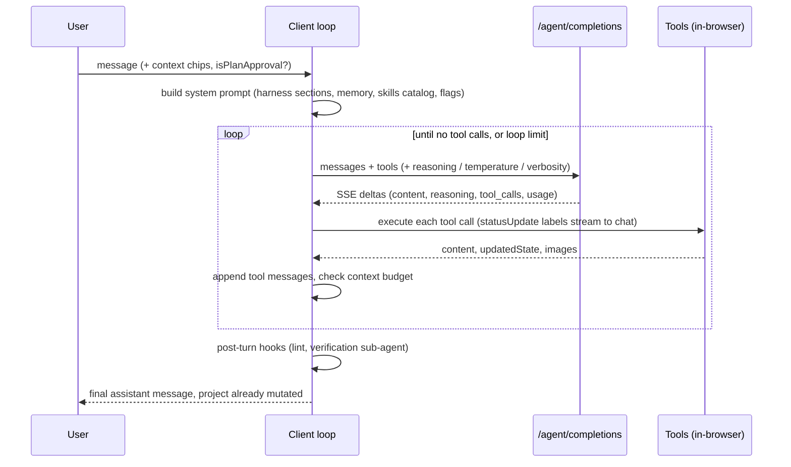

# Underlord agent protocol

How one Underlord turn runs, end to end. Evidence tags: **decompiled** (read in the client chunks), **inferred** (reasoned from the client, not seen on the wire), **signed-in gap** (needs a HAR; see [signed-in-gaps.md](signed-in-gaps.md)).

## Two execution modes

| Mode | Gate | Who runs the loop | Transport |
| --- | --- | --- | --- |
| **Local** (default) | flag `underlord-use-cloud-agent` off | The browser. The app runs the loop, calls the model through Descript's gateway, and runs tools against the in-memory project document | `POST /agent/completions` (OpenAI chat-completions shaped body, SSE response) |
| **Cloud** | flag `underlord-use-cloud-agent` on | Descript's backend. The client sends the user message plus a snapshot of editor state and renders streamed events | `POST /cloudagent/chats` (first turn) or `POST /cloudagent/chats/{chatId}/turns`, SSE response; `GET .../turns/{turnId}/events` to resume, `POST .../turns/{turnId}/cancel` to stop |

**decompiled.** A dev/eval fallback in the shared package can call OpenRouter or OpenAI directly with a locally configured key. That is a developer path, not production.

## Local turn

### Completion request (decompiled)

Fields the client sends per call: `conversation_id`, `turn_id`, `request_id`, `call_source` (`main` or a sub-agent source), `call_source_stack`, `model`, `messages`, `tools`, `tool_choice`, `stream`, `stream_options.include_usage: true`, `response_format` (strict JSON schema when a tool needs structured output), `max_completion_tokens`, then either `reasoning` or `temperature`, plus optional `anthropic_beta_features`, `verbosity`, `context` (user message context chips), `persist`, `assistant_message_id`.

- Retries: up to 3 attempts per stream (harness can override) with backoff of 500 ms × 2^(n−1), only for retryable stream errors and not after abort. The HTTP call itself also retries up to 3 times on network errors.
- Response headers `X-Descript-Conversation-Encoded-Span` and `X-Descript-Call-Source-Encoded-Span` carry trace spans that the client uses to nest sub-agent telemetry under the main turn.
- Prompt caching: the client marks the last text part of selected user/tool messages with `cache_control: {type: "ephemeral", ttl}`, Anthropic-style. That tells us the gateway forwards to Anthropic-family models for at least some harnesses.
- One constant in the shared package names a Sonnet-class model as the fallback main model. Which models run in production is chosen by the `agent-model-main` and related flags (**signed-in gap**).

### Streaming parse (decompiled)

SSE lines are `data: {json}` until `data: [DONE]`. Each chunk's `choices[0].delta` may carry `content`, `reasoning`, `reasoning_details[]` (types `reasoning.summary`, `reasoning.encrypted`, `reasoning.text`), and indexed `tool_calls[]` fragments that are concatenated by index. `usage` arrives on the final chunk. `finish_reason: "error"` mid-stream raises a provider-down error. A stream that closes after a finish reason but without `[DONE]` is accepted with a warning.

### Loop limits (decompiled)

- `agent-max-loop-main`: default **25** model round-trips per main turn.
- `agent-max-loop-global`: default **300** across main plus sub-agents.
- Harnesses can override both.

### Context budget (decompiled)

Per call the client estimates input tokens (characters ÷ 4 for tools plus a message estimator), preferring the measured `usage` from the last response when that number is larger. Then:

- `hardBoundary = min(0.8 × limit, limit − min(32k reserve + 8k margin, limit/2))`
- At or below the boundary, an **advisory** may be injected once when usage crosses a model-specific ratio (default 0.5). It tells the model it may call `compact_context` or `summarize_context`.
- Above the boundary, the client **auto-compacts** if compaction would save at least 15%, else **force-summarizes** if a summary collapse is available, else gives up (`noSafeCollapse`).
- On a provider "context length exceeded" error (matched on several message strings), it retries once after compaction (`overflowRetry`).
- Encrypted reasoning blocks from older turns are stripped before resending.

### Message model (decompiled)

A conversation is a list of typed messages: `user` (with `context`, optional `isPlanApproval`, optional `agentTemplateTitle`), `assistant`, `tool` (with `status`: running, completed, failed, aborted), and `rollback` markers. Saved summaries replace the message ranges they cover when the history is rebuilt. Rollback markers are filtered out of what the model sees.

## Cloud turn events (decompiled)

The SSE event `type` values the client handles:

| Event | Client effect |
| --- | --- |
| `turn_started` | Record `turn_id` and `chat_id`; persist the chat id on the project |
| `assistant_chunk` | Append `content` to the message keyed by `assistant_message_id` (temporary, `running`) |
| `assistant_retry` | Reset the in-progress assistant text |
| `assistant_message_completed` | Mark the message completed |
| `tool_call_started` / `tool_call_completed` | Show and finish a tool row with its label |
| `turn_completed` | Finish the turn, carrying `usage` |
| `turn_failed` / `turn_cancelled` | Error state / aborted |

If the stream drops, the client shows a "stream dropped" error and can resume through the events endpoint. What the cloud returns in place of `updatedState` (document patches or a new commit ref the client pulls) is not visible in the client (**signed-in gap**). The request carries `app_state`, `client_state` and `commit_ref`, so the server presumably edits a server-side copy of the project at that commit (**inferred**).

## Planning and approval (decompiled)

1. Some skills, or the model on its own judgment, call `enter_planning`. While in planning mode the model is told it may query but not change the project, and should present a plan (todo list plus a plan message). The restriction lives in the tool and prompt text; we did not find a code-level block on edit tools (**decompiled**, enforcement **signed-in gap**). One harness variant instead loads the `video-planning-brief` skill and tells the model not to mention planning mode to the user.
2. The UI renders the plan with an approve action. Approving sends a normal user message flagged `isPlanApproval: true` (`is_plan_approval` on the wire).
3. The model calls `exit_planning` and executes.

## Rollback (decompiled)

Each turn records the project's commit ref. Rolling back to a user message reverts the project to the commit before that turn. The server marks the later messages `rolledBackAt`, and on reload the client collapses each run of rolled-back messages into one `rollback` marker (`rollbackToTimestamp`, `rollbackMessageId`, `removedMessages`, `source: "history"`) so the user can see and re-send what was removed.

## Chat persistence and feedback (decompiled)

- `GET /agent/chats`, `GET`, `PATCH` and `DELETE /agent/chats/{id}`: list, load, rename and delete chats. Creation is not a separate call in the client; chats appear to be created server-side by the first `/agent/completions` with `persist` (**inferred**).
- `POST /agent/feedback`: thumbs up or down per message.
- Personal memory and skills go through `/agent-instructions` endpoints.

## Credits (decompiled + signed-in gap)

The client checks the account's paywall and credit state before turns and injects a line into the system prompt ("account restricted by a paywall" or "has enough credits; operations still consume credits"). Generation tools return model-facing messages like "not enough AI credits, tell the user to upgrade". Out-of-credits is a distinct turn failure reason. How a turn's tokens and tool usage turn into credits is not computed in the client (**signed-in gap**).

## Post-turn hooks (decompiled)

After the final assistant message:

1. The **project linter** runs over changed scenes (`lint_project` can also be called mid-turn).
2. Behind flags, a **verification sub-agent** (`call_source: post-turn-verification`) reviews the turn and can push a follow-up correction turn.
3. A tool-call summary event goes to analytics.
