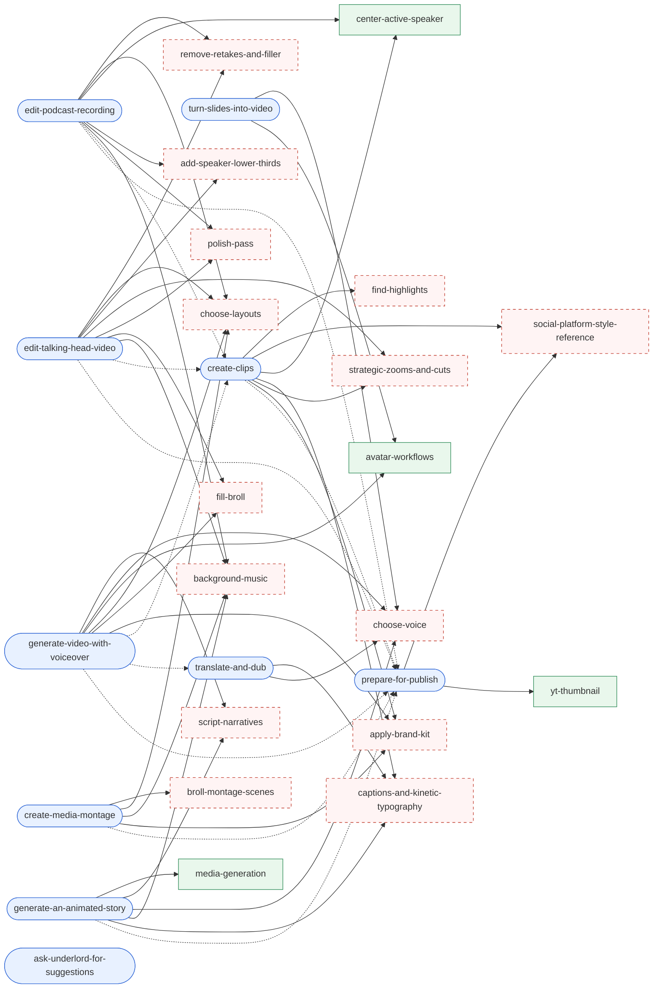

# Skill reference graph

**decompiled.** Built by scanning every skill body in the client registry for `{{name}}` references (sub-skills) and `{{→ Display Name}}` references (follow-up links to another macro skill). The client does not expand either form at runtime; the model sees them as text.

Legend: rounded = user workflow skill, rectangle with a solid border = sub-skill whose body **is** in the client, dashed = referenced sub-skill with **no body anywhere** in the downloaded chunks. Dotted arrows are follow-up suggestions.

## Present vs missing

| Sub-skill id | Referenced by | Body in client? | Closest thing we do have |
| --- | --- | --- | --- |
| `center-active-speaker` | create-clips, edit-podcast-recording | **present** (confidential skill, gate `vs-cas-v2`) | full workflow, see [skill-library.md](skill-library.md#confidential-user-skills) |
| `avatar-workflows` | generate-video-with-voiceover, turn-slides-into-video | **present** (guidance) | |
| `media-generation` | generate-an-animated-story | **present** (guidance) | |
| `yt-thumbnail` | prepare-for-publish | **present** (guidance) | |
| `find-highlights` | create-clips | **missing** | AI action kebab id `find-highlights` exists (**static-bundle**); `annotate_transcript` can add highlight spans and `query_script_markdown` / `find_in_script` can read them back (**decompiled**). No scoring logic anywhere |
| `social-platform-style-reference` | create-clips, prepare-for-publish | missing | |
| `captions-and-kinetic-typography` | create-clips, translate-and-dub, generate-an-animated-story | missing | `query_captions`, `query_kinetic_typography_presets`, `create_kinetic_typography` tools, and the kinetic-typography sub-agent call sources (moment selection, chunking, emphasis, placement) |
| `strategic-zooms-and-cuts` | create-clips, edit-talking-head-video | missing | `zoom-at-jump-cuts` guidance (present) covers the zoom half; `query_jump_cuts`, `apply_zoom_at_jumpcuts`, `shorten_word_gaps` |
| `apply-brand-kit` | create-clips, create-media-montage, generate-video-with-voiceover | missing | `query_brand_kit`, `copy_brand_asset_to_media_library`, `copy_brand_font_to_project` |
| `choose-layouts` | edit-talking-head-video, edit-podcast-recording, create-media-montage, generate-video-with-voiceover | missing | `query_layouts`, `update_scene_properties` (layout ids), `design_scene_layout` (experiment) |
| `remove-retakes-and-filler` | edit-talking-head-video, edit-podcast-recording | missing | `edit_narration`, the "default cleanup" line in the system prompt, AI action `remove-retakes-v2` |
| `add-speaker-lower-thirds` | edit-talking-head-video, edit-podcast-recording | missing | `insert_track` (title), `query_speakers` |
| `polish-pass` | edit-talking-head-video, edit-podcast-recording | missing | |
| `fill-broll` | edit-talking-head-video, generate-video-with-voiceover | missing | placeholder tracks, `search_stock_media`, `generate_images`, `generate_video` |
| `background-music` | edit-talking-head-video, edit-podcast-recording, create-media-montage, generate-an-animated-story | missing | `search_stock_media` (music), `generate_music`, ducking on `modify_track` |
| `choose-voice` | translate-and-dub, generate-video-with-voiceover, generate-an-animated-story, turn-slides-into-video | missing | `query_ai_voices`, `assign_speaker`, `get_dub_speakers` |
| `script-narratives` | generate-video-with-voiceover, generate-an-animated-story | missing | |
| `broll-montage-scenes` | create-media-montage | missing | |

Count: 18 distinct sub-skill references, 4 with bodies, 14 without.

## Why they might be missing

Our reading, all **inferred**:

1. The flag catalog calls these "first-draft" workflow skills, added 2026-09-09. The sub-skills may simply not be written yet, and the model fills the gap with tools and the system prompt.
2. They may live on the backend and be served by `/agent-instructions/{id}/content` with `source: "drive"` or a global scope the client does not list. The client's global loader only knows the 21 local records, so a `load_skill` call with `source: "global"` for `find-highlights` would return a not-found error in the client loop.
3. The server could rewrite `{{ref}}` text inside `/agent/completions` before it reaches the model. There is no client evidence for this.
4. The cloud-agent runtime (server side) may carry its own, fuller library.

A signed-in session settles this: watch for `load_skill` tool calls with these ids and what comes back. See [signed-in-gaps.md](signed-in-gaps.md).
